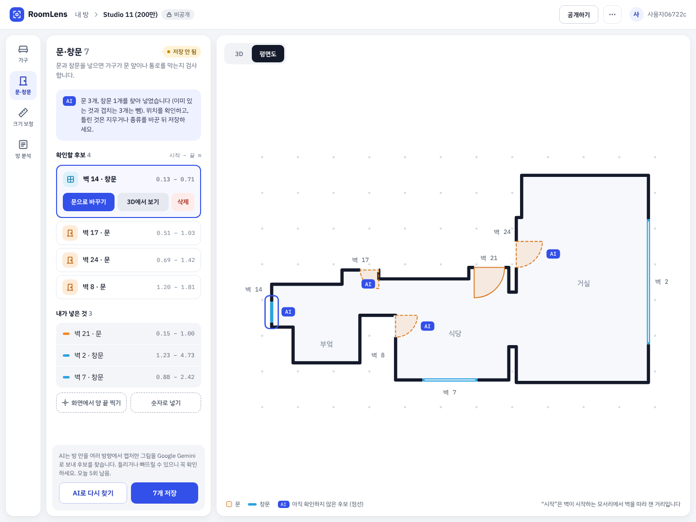
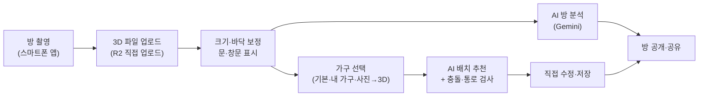
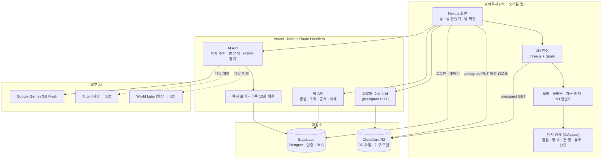

# RoomLens

**AI 기반 자취방 3D 복원 및 가구 배치 시뮬레이션 웹 서비스**

휴대폰으로 찍은 방을 3D 가우시안 스플래팅으로 복원해 웹에서 둘러보고, 벽 하나의 길이로 방을 실제 크기(m)에 맞춘 뒤, 실제 치수의 가구를 놓아 보고 AI에게 배치를 추천받는 서비스입니다.

- 서비스 주소: https://roomlens-seven.vercel.app
- 개발: 1인 개인 프로젝트 (2026 교내 AI 경진대회 출품작)
- 개발 기간: 2026년 9월 29일 ~ 11월 (발표)


## 목차

1. [해결하려는 문제](#해결하려는-문제)
2. [주요 기능](#주요-기능)
3. [화면 예시](#화면-예시)
4. [사용 흐름](#사용-흐름)
5. [생성형 AI 활용](#생성형-ai-활용)
6. [시스템 구조](#시스템-구조)
7. [기술 스택](#기술-스택)
8. [데이터 모델](#데이터-모델)
9. [서버 API](#서버-api)
10. [폴더 구조](#폴더-구조)
11. [개발 현황과 일정](#개발-현황과-일정)
12. [로컬 실행](#로컬-실행)
13. [테스트](#테스트)
14. [개인정보와 안전장치](#개인정보와-안전장치)
15. [데이터·모델 출처와 라이선스](#데이터모델-출처와-라이선스)

## 해결하려는 문제

자취방을 구하거나 이사할 때 사진 몇 장만으로는 방의 실제 크기와 구조를 알기 어렵고, 지금 가진 침대·책상·옷장이 새 방에 들어가는지는 가 보기 전까지 모릅니다.

| 사용자의 고민 | RoomLens의 해결 방법 |
| --- | --- |
| 방에 가지 않고도 실제 크기와 구조를 알고 싶다 | 3D 방 투어 + 실제 치수 보정 |
| 옵션과 방 상태를 빠르게 확인하고 싶다 | AI 방 분석 리포트 |
| 지금 가진 가구가 들어가는지 미리 보고 싶다 | 가구 배치 시뮬레이션 (겹침·문 앞·통로 검사) |
| 가구를 어떻게 놓아야 할지 모르겠다 | AI 가구 배치 추천 |
| 내 가구가 기본 목록에 없다 | 내 가구 직접 만들기, 가구 사진 → 3D 모델 변환 |
| 앱을 따로 설치하고 싶지 않다 | 모바일 웹 지원 |

## 주요 기능

### 1. 3D 방 복원과 투어

- Scaniverse 같은 앱으로 찍은 방의 3D 파일(`.spz`, `.ply`, `.sog`, `.rad`, 100MB 이하)을 올리면 웹에서 3D로 둘러볼 수 있습니다.
- [Spark](https://sparkjs.dev) 렌더러의 LOD로 폰에서도 그립니다 (iPhone 15 Pro 실측: 60FPS, 로딩 약 8.5초).
- 파일은 브라우저가 Cloudflare R2에 직접 올리므로 서버 요청 크기 제한(4.5MB)과 상관없습니다.
- 마우스 끌기·휠, 키보드(W A S D, Q E, Shift)로 걸어 다니고, 보정된 방에서는 카메라가 벽 밖으로 나가지 않습니다.

### 2. 크기·바닥 보정

- 바닥 모서리를 차례로 찍고 벽 하나의 실제 길이를 넣으면 방 전체가 미터 단위가 됩니다.
- 모서리 3~32개를 지원해 ㄱ자·ㄷ자처럼 사각형이 아닌 방(집 전체)도 넣을 수 있습니다.
- "직각으로 맞추기"가 손으로 찍은 오차를 바로잡습니다 (실측: 벽 길이 오차 최대 0.97% → 0.01%).
- 문과 창문은 화면에서 양 끝을 찍거나 숫자로 넣습니다.

### 3. 가구 배치 시뮬레이션

- 실제 치수의 기본 가구 10종(싱글·슈퍼싱글·퀸 침대, 책상, 의자, 옷장, 행거, 서랍장, 2인 식탁, 책장)과 내가 치수를 넣어 만든 가구를 바닥 위에서 끌고 90°씩 돌립니다.
- 3D와 2D 평면도를 오가며 같은 배치를 고칠 수 있습니다.
- 놓을 때마다 6가지를 검사해 빨강(문제)·노랑(경고)으로 알려 줍니다.

  | 검사 | 기준 |
  | --- | --- |
  | 겹침 | 회전된 직사각형끼리 분리축 정리(SAT), 2cm까지 허용 |
  | 방 밖 | 가구 밑면이 방 평면도 밖으로 나감 |
  | 문 앞 | 문 폭 × 폭 정사각형(여닫는 공간)과 겹침 |
  | 통로 | 문에서 가구까지 폭 60cm로 걸어갈 수 없음 (5cm 격자 BFS) |
  | 창문 가림 (경고) | 높이 1m가 넘는 가구가 창문 앞 0.3m 안에 있음 |
  | 쓰는 쪽 (경고) | 책상·옷장의 앞, 침대의 긴 변 등 쓰는 공간이 막힘 |

- 배치는 저장해 두었다가 다시 열 수 있습니다.

### 4. AI 가구 배치 추천

- "책상은 창가에"처럼 바라는 점을 적으면 Gemini가 어떤 가구를 어느 벽·구역에 둘지 계획하고, 코드(배치 솔버)가 실제 좌표를 계산해 위 6가지 검사를 통과하는 자리에 놓습니다.
- 못 놓은 가구가 있으면 그 이유를 Gemini에 다시 보내 계획을 고치게 합니다 (최대 3회).
- 결과는 내 배치를 덮어쓰지 않고 별도의 "AI 배치"로 저장되며, 가구마다 추천 이유와 지키지 못한 조건을 보여 줍니다.

### 5. AI 방 분석 리포트

- 방 안에서 여러 방향으로 캡처한 3D 화면(과 선택한 사진)을 Gemini가 보고 옵션(에어컨·세탁기 등), 수납·채광, 눈에 띄는 문제, 제안을 정리합니다.
- 보이지 않는 것은 "알 수 없음"으로 표시하고, 문제 항목은 "AI 참고용, 직접 확인 필요"로 안내합니다.

### 6. 문·창문 AI로 찾기

- 3D 화면 캡처 최대 18장에서 Gemini가 문·창문의 위치(이미지 속 상자)를 찾으면, 카메라 위치와 시야각으로 광선을 쏘아 실제 벽 위의 구간(m)으로 바꿉니다.
- 결과는 후보로만 넣고, 사용자가 3D에서 확인한 뒤 저장합니다.

### 7. 공유 (진행 중)

- 공개로 바꾼 방은 홈 목록에 올라가고, 다른 사람도 3D로 둘러보며 자기 배치를 따로 만들어 볼 수 있습니다.
- 코멘트와 배치 공개는 개발 중입니다.

### 8. 가구 사진 → 3D, 영상 → 3D 방 (개발 예정)

- 가구 사진 한 장을 생성형 3D AI(Tripo)로 3D 모델(GLB)로 만들고, 입력한 치수에 맞춰 방에 놓습니다.
- 짧은 영상만으로 3D 방을 만드는 간편 모드(World Labs)를 선택 기능으로 넣습니다.

## 화면 예시

| 가구 배치 (3D) | 평면도 + AI 배치 추천 결과 |
| --- | --- |
|  |  |
| **문·창문 AI 후보 확인** | **AI 방 분석 리포트** |
|  |  |

| 방 만들기 (업로드·동의) | 폰 화면 (AI 추천 결과) |
| --- | --- |
|  |  |

- 방 화면은 왼쪽 도구 줄(가구 / 문·창문 / 크기 보정 / 방 분석) + 패널 하나 + 3D 화면 구조입니다. 폰에서는 도구 줄이 아래 탭, 패널이 아래에서 올라오는 판이 됩니다.
- 방 화면 그림은 운영 데이터(샘플 방 Studio 11)로 만든 화면 디자인이며, 같은 구조가 서비스에 적용되어 있습니다.

## 사용 흐름



촬영하지 않아도 쓸 수 있도록, 공개 라이선스(CC BY 4.0) 3D 장면을 샘플 방으로 올려 두었습니다.

## 생성형 AI 활용

LLM은 "무엇을 어디에 둘지" 같은 판단만 맡고, 좌표·치수·충돌처럼 정확해야 하는 계산은 코드가 맡습니다. LLM은 위치·크기 정확도가 낮기 때문입니다.

| 기능 | AI | 입력 | AI가 하는 일 | 코드가 하는 일 |
| --- | --- | --- | --- | --- |
| 3D 방 복원 | 3D 가우시안 스플래팅 (Scaniverse), World Labs Marble(선택) | 방 촬영 / 짧은 영상 | 여러 장의 이미지에서 3D 공간 재구성 | 웹 렌더링(LOD), 실제 크기 보정 |
| 가구 배치 추천 | Gemini 3.8 Flash | 방 요약(벽 길이·문·창문 위치), 가구 목록, 요청 문장 | 가구별 구역·벽·방향·우선순위와 이유를 JSON으로 | 좌표 계산, 6가지 검사, 실패 이유를 붙여 재요청(최대 3회) |
| 방 분석 리포트 | Gemini 3.8 Flash (비전) | 3D 화면 캡처 6~8장 + 사진(선택) | 옵션·수납·채광·문제·제안을 JSON으로 | 형식 검증·정리, 저장, 화면 표시 |
| 문·창문 찾기 | Gemini 3.8 Flash (비전) | 3D 화면 캡처 최대 18장 | 그림 속 문·창문 상자(`box_2d`) | 광선으로 벽 위 구간 계산, 여러 그림 결과 합치기 |
| 가구 사진 → 3D | Tripo (image-to-model) | 가구 사진 1장 + 치수 | 형태·질감을 갖춘 GLB 생성 | 작업 상태 확인, R2 저장, 치수 맞춤 |

**AI 출력을 믿을 수 있게 만드는 장치**

- 모든 Gemini 응답은 JSON 스키마(`zod` → `z.toJSONSchema`)로 형식을 지정하고, 받은 뒤 다시 검증합니다.
- 프롬프트에는 좌표·치수를 지어내지 말고 주어진 벽 id(`W1..Wn`)와 가구 id만 쓰라고 지시합니다. 방 요약에는 좌표를 보내지 않습니다.
- 사용자 요청 문장은 줄바꿈을 없애고 200자로 잘라, 방 요약의 구조를 바꾸지 못하게 합니다.
- AI 호출은 로그인한 사람만, 한 사람당 하루 10회까지 (세 AI 기능이 함께 씀).
- 데이터를 학습에 쓰지 않는 Gemini 유료 티어를 씁니다.

## 시스템 구조

무거운 3D 복원은 휴대폰(또는 외부 API)에서, AI는 외부 API에서 처리하고, 큰 파일은 브라우저가 R2에 직접 올립니다. 서버는 업로드 주소 발급, AI 호출, 배치 검증만 맡아 Vercel 무료 플랜의 제한(함수 300초, 요청 4.5MB) 안에서 동작합니다.



## 기술 스택

| 영역 | 사용 기술 |
| --- | --- |
| 프레임워크 | Next.js 16 (App Router, TypeScript), React 19 |
| 3D | three.js r186, [Spark](https://sparkjs.dev) 2 (3D 가우시안 스플래팅 렌더러, LOD) |
| 스타일 | Tailwind CSS 4, IBM Plex Sans KR / IBM Plex Mono |
| DB·인증 | Supabase (Postgres, 이메일 로그인, Row Level Security) |
| 파일 저장 | Cloudflare R2 (S3 호환, presigned URL) |
| 생성형 AI | Google Gemini 3.8 Flash (`@google/genai`), Tripo, World Labs |
| 스키마 검증 | zod 4 |
| 테스트 | vitest (단위 테스트), Playwright 기반 실측 스크립트 |
| 배포 | Vercel |

## 데이터 모델

DB에는 메타데이터와 JSON(보정 값, 배치, 리포트)만 두고, 파일은 모두 R2에 둡니다. 모든 테이블에 RLS를 걸어 본인 데이터와 공개된 방만 읽을 수 있습니다.

| 테이블 | 내용 |
| --- | --- |
| `profiles` | 닉네임, 만 18세 확인 |
| `rooms` | 방 정보, 공개 여부, 3D 파일 키, 보정 값(`transform`), 바닥 평면도(`floor_polygon`), 문·창문(`openings`), 출처(데이터셋 방) |
| `room_reports` | AI 방 분석 리포트 (방마다 최신 하나) |
| `furniture_catalog` | 기본 가구 10종의 치수, 3D 모델 키, 라이선스 |
| `user_furniture` | 사용자가 만든 내 가구 |
| `layouts` | 가구 배치 (`created_by`: `user` / `ai`, AI 요약·이유) |
| `ai_calls` | AI 호출 기록 (하루 10회 제한 계산) |
| `comments`, `jobs` | 코멘트, 오래 걸리는 외부 작업(Tripo·World Labs) 상태 |

마이그레이션 SQL은 [`supabase/migrations/`](supabase/migrations)에 있습니다.

## 서버 API

| 메서드 | 경로 | 설명 |
| --- | --- | --- |
| `POST` | `/api/rooms` | 방 만들기 (업로드 동의 시각 저장) |
| `POST` | `/api/upload-url` | 3D 파일을 R2에 올릴 presigned PUT 주소 발급 |
| `GET` · `PATCH` · `DELETE` | `/api/rooms/[id]` | 방 조회, 업로드 확인·공개 전환, 삭제(R2 파일 포함) |
| `POST` | `/api/rooms/[id]/layout-suggest` | AI 가구 배치 추천 |
| `POST` | `/api/rooms/[id]/analyze` | AI 방 분석 |
| `POST` | `/api/rooms/[id]/openings-suggest` | 문·창문 AI로 찾기 (후보만 돌려줌) |

## 폴더 구조

```
roomlens/
├─ app/                    # 화면(App Router)과 서버 API(Route Handlers)
│  ├─ page.tsx             # 홈: 공개 방 · 내 방 목록
│  ├─ rooms/new/           # 방 만들기 (업로드 · 동의)
│  ├─ rooms/[id]/          # 방 화면 (3D · 보정 · 문창문 · 가구 · 분석)
│  └─ api/                 # rooms, upload-url, AI API
├─ components/
│  ├─ viewer/              # 3D 뷰어, 보정 도구, 문·창문 도구, 분석 패널
│  ├─ layout/              # 가구 배치 레이어, 2D 평면도
│  └─ rooms/ · ui/ · auth/
├─ lib/
│  ├─ three/               # 보정 변환, 직각 맞추기, 바닥 드래그, 캡처, 카메라
│  ├─ layout/              # 기하(SAT), 배치 검사, 통로 BFS, 배치 솔버
│  ├─ ai/                  # Gemini 호출, 프롬프트, 스키마, 방 요약, 호출 제한
│  ├─ rooms/ · upload/ · supabase/ · r2.ts
├─ supabase/migrations/    # DB 스키마 · RLS
├─ scripts/                # 개발용 데이터 · 가구 모델 · 실측 스크립트
└─ tests/                  # vitest 단위 테스트
```

## 개발 현황과 일정

| 단계 | 기간 (계획) | 내용 | 상태 |
| --- | --- | --- | --- |
| M0 기술 검증 | 9/29 ~ 10/5 | 3D 뷰어, 크기 보정 프로토타입, 가구 드래그, Gemini 구조화 출력 | 완료 |
| M1 업로드·저장 | 10/6 ~ 10/12 | 로그인, R2 업로드, 방 만들기·방 화면, 공개/비공개·삭제 | 완료 |
| M2 보정·가구 배치 | 10/13 ~ 10/19 | 다각형 보정, 문·창문, 가구 10종·내 가구, 6가지 검사, 2D 평면도, 배치 저장 | 완료 |
| M3 AI | 10/20 ~ 10/26 | AI 배치 추천, AI 방 분석, 문·창문 AI로 찾기, 화면 디자인 적용 | 완료 |
| M4 기능 완성·공개 | 10/13 ~ 11/2 | 공유(코멘트·배치 공개), 가구 사진 → 3D, 영상 → 3D, 모바일 다듬기, 10/27 공개 오픈 | 진행 중 |
| M5 사용자 테스트 | 11/3 ~ 11/16 | 사용자 10명 이상, 만족도 설문(10문항 이상), 개선, 11/16 최종 완성 | 예정 |
| 발표 | 11/17 ~ 발표일 | 발표 자료, 시연 영상, 리허설 | 예정 |

작업은 이슈 → 브랜치 → PR → merge commit 순서로 진행합니다 (squash 하지 않음).

## 로컬 실행

Node.js 22 이상이 필요합니다.

```bash
npm install
cp .env.example .env.local   # 값 채우기
npm run dev
```

http://localhost:3000 에서 확인합니다.

| 환경변수 | 용도 |
| --- | --- |
| `NEXT_PUBLIC_SUPABASE_URL`, `NEXT_PUBLIC_SUPABASE_PUBLISHABLE_KEY` | Supabase 프로젝트 주소·공개 키 |
| `SUPABASE_SECRET_KEY` | 서버 전용 작업 |
| `R2_ACCOUNT_ID`, `R2_ACCESS_KEY_ID`, `R2_SECRET_ACCESS_KEY`, `R2_BUCKET` | Cloudflare R2 |
| `GEMINI_API_KEY`, `GEMINI_MODEL` | Gemini (기본 `gemini-3.8-flash`) |
| `TRIPO_API_KEY`, `WORLDLABS_API_KEY` | 가구 사진 → 3D, 영상 → 3D (선택) |

키는 `.env.local`과 Vercel 환경변수에만 두고 저장소에 올리지 않습니다.

## 테스트

```bash
npm test        # vitest 단위 테스트 (417개)
npm run lint
npm run build
```

- 단위 테스트는 브라우저 없이 도는 순수 계산(보정 변환, 직각 맞추기, 겹침·통로 검사, 배치 솔버, 방 요약, 문·창문 위치 계산 등)을 다룹니다.
- `scripts/dev-data/e2e-*.mjs`는 실제 브라우저로 화면을 조작해 업로드·보정·가구 배치·AI 기능을 확인하는 실측 스크립트입니다.

## 개인정보와 안전장치

- 방 3D 파일과 사진은 집 안 모습이 담긴 개인정보로 다룹니다. 업로드 전에 수집 항목·용도·AI 전송·보관 기간을 보여 주고 동의를 받습니다.
- 올린 방은 기본 비공개이고, 방을 지우면 R2의 파일도 함께 지웁니다.
- AI 방 분석에 보낸 그림은 저장하지 않습니다.
- Gemini 약관에 따라 만 18세 이상만 가입할 수 있습니다.
- 가격·계약 조건·연락처는 받지 않습니다 (매물 광고로 쓰이지 않도록).

## 데이터·모델 출처와 라이선스

| 자료 | 출처 | 라이선스 | 쓰는 곳 |
| --- | --- | --- | --- |
| Studio 11 | milanoski, [SuperSplat](https://superspl.at/scene/c37cb759) | CC BY 4.0 | 샘플 방, 홈·화면 예시 그림 |
| HAUSSMANN APARTMENT | Stéphane Agullo (sa3d), [SuperSplat](https://superspl.at/scene/4de797f4) | CC BY 4.0 | 가구 없는 샘플 방 |
| Furniture Kit | [Kenney](https://kenney.nl/assets/furniture-kit) | CC0 | 기본 가구 3D 모델 9종 |
| InteriorGS | Hugging Face 데이터셋 | 비상업 연구·교육 전용 | 개발 중 검증용 (저장소·공개 방에 올리지 않음) |

데이터셋 원본 파일은 저장소에 포함하지 않습니다.
