# RoomLens

**AI 기반 방·집 3D 복원 및 가구 배치 시뮬레이션 웹 서비스**

휴대폰으로 찍은 방이나 집 전체를 3D 가우시안 스플래팅으로 복원해 웹에서 둘러보고, AI가 방의 크기·벽·문·창문·원래 있던 가구를 찾아 실제 크기(m)로 맞춘 뒤, 실제 치수의 가구를 놓아 보고 AI에게 배치를 추천받는 서비스입니다.
이사 갈 방은 가 보지 않고, 지금 사는 방은 가구를 옮기지 않고 미리 배치해 볼 수 있습니다.

- 서비스 주소: https://roomlens-seven.vercel.app
- 개발: 1인 개인 프로젝트 (2026 교내 AI 경진대회 출품작)
- 개발 기간: 2026년 9월 29일 ~ 11월 (발표)

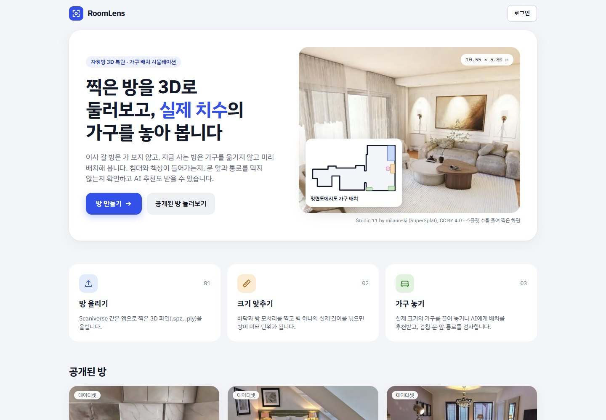

## 목차

1. [해결하려는 문제](#해결하려는-문제)
2. [주요 기능](#주요-기능)
3. [화면 예시](#화면-예시)
4. [사용 흐름](#사용-흐름)
5. [생성형 AI 활용](#생성형-ai-활용)
6. [AI 성능 측정](#ai-성능-측정)
7. [시스템 구조](#시스템-구조)
8. [기술 스택](#기술-스택)
9. [데이터 모델](#데이터-모델)
10. [서버 API](#서버-api)
11. [폴더 구조](#폴더-구조)
12. [개발 현황과 일정](#개발-현황과-일정)
13. [로컬 실행](#로컬-실행)
14. [테스트](#테스트)
15. [개인정보와 안전장치](#개인정보와-안전장치)
16. [데이터·모델 출처와 라이선스](#데이터모델-출처와-라이선스)

## 해결하려는 문제

방이나 집을 구하거나 이사할 때 사진 몇 장만으로는 실제 크기와 구조를 알기 어렵고, 지금 가진 침대·책상·옷장이 새 방에 들어가는지는 가 보기 전까지 모릅니다. 지금 사는 방의 가구를 다시 배치하려 해도, 무거운 가구를 직접 옮겨 보기 전에는 결과를 알 수 없습니다.

| 사용자의 고민 | RoomLens의 해결 방법 |
| --- | --- |
| 방에 가지 않고도 실제 크기와 구조를 알고 싶다 | 3D 방 투어 + AI 자동 보정(실제 치수) |
| 지금 사는 방의 가구를 옮기기 전에 결과를 보고 싶다 | 스캔 속 원래 가구를 3D 그대로 떼어 내 옮겨 보고, 빈자리는 AI로 채움 |
| 옵션과 방 상태를 빠르게 확인하고 싶다 | AI 방 분석 리포트 |
| 지금 가진 가구가 들어가는지 미리 보고 싶다 | 가구 배치 시뮬레이션 (겹침·문 앞·통로 검사) |
| 가구를 어떻게 놓아야 할지 모르겠다 | AI 가구 배치 추천 |
| 내 가구가 기본 목록에 없다 | 치수로 내 가구 만들기, 3D 스캔한 가구 올리기 |
| 다른 사람의 의견을 듣고 싶다 | 방 공개, 코멘트, 배치 공유 링크 |
| 앱을 따로 설치하고 싶지 않다 | 모바일 웹 지원 |

## 주요 기능

### 1. 3D 방 복원과 투어

- Scaniverse 같은 앱으로 찍은 방의 3D 파일(`.spz`, `.ply`, `.sog`, `.rad`, 100MB 이하)을 올리면 웹에서 3D로 둘러볼 수 있습니다.
- [Spark](https://sparkjs.dev) 렌더러의 LOD로 폰에서도 그립니다 (iPhone 15 Pro 실측: 60FPS, 로딩 약 8.5초).
- 파일은 브라우저가 Cloudflare R2에 직접 올리므로 서버 요청 크기 제한(4.5MB)과 상관없습니다.
- 마우스 끌기·휠, 키보드(W A S D, Q E, Shift), 폰 두 손가락으로 움직이고, 보정된 방에서는 카메라가 벽 밖으로 나가지 않습니다.
- 촬영하지 않아도 쓸 수 있도록 공개 라이선스(CC BY 4.0) 장면 10개를 샘플 방으로 공개해 두었습니다.

### 2. AI로 방 준비하기 (크기 보정 · 문·창문 · 원래 가구)

- **자동 보정 (AI 호출 없이 브라우저에서 약 1초):** 3D 장면의 표면 점 60만 개에서 위아래 방향, 바닥·천장 높이, 벽 방향과 위치를 찾아 방 평면도를 만들고 미터 단위로 맞춥니다. 천장 높이로 크기를 짐작하고, 벽 하나의 실제 길이를 넣으면 정확하게 맞춥니다.
- **문·창문 찾기:** 벽마다 정면 그림을 찍어 Gemini가 문·창문을 찾으면, 그림 속 위치를 벽 위의 구간(m)으로 바꿉니다.
- **원래 가구 찾기:** 천장을 잘라 낸 위에서 본 그림으로 Gemini가 침대·옷장·냉장고 같은 가구를 찾고, 높이는 3D 점에서 잽니다.
- 결과는 모두 후보로 넣고 사용자가 3D·평면도에서 확인합니다. 어긋난 벽은 평면도에서 끌어 고치고, 바닥 모서리를 직접 찍는 방식(모서리 3~32개, ㄱ자·ㄷ자 방, "직각으로 맞추기")도 그대로 쓸 수 있습니다.
- 다시 보정해도 저장된 배치·문·창문·원래 가구가 새 좌표로 함께 옮겨집니다.

### 3. 가구 배치 시뮬레이션

- 실제 판매 상품을 스캔한 3D 모델(Amazon Berkeley Objects)로 만든 기본 가구 **18종 × 두 모양 = 36가지**: 싱글·슈퍼싱글·퀸 침대, 책상, 의자, 옷장, 행거, 서랍장, 2인 식탁, 책장, 소파, TV장, 협탁, 커피테이블, 신발장, 화장대, 수납 벤치, 스탠드 조명.
- **내 가구:** 이름과 치수만 넣어 만들거나, Scaniverse로 스캔한 가구(GLB)를 올리면 브라우저가 함께 찍힌 바닥을 지우고 수평·방향·크기를 맞춰 3D 모델로 만듭니다.
- 바닥 위에서 끌고, 자유롭게 돌리고(평면도 손잡이·각도 입력·R 키), 되돌리기·다시하기(Ctrl+Z, 최근 50단계)를 할 수 있습니다. 3D와 2D 평면도를 오가며 같은 배치를 고칩니다.
- 끄는 동안에도 6가지를 검사해 빨강(문제)·노랑(경고)으로 알려 줍니다. 원래 있던 가구도 장애물로 봅니다(치울 가구로 표시하면 뺌).

  | 검사 | 기준 |
  | --- | --- |
  | 겹침 | 회전된 직사각형끼리 분리축 정리(SAT), 2cm까지 허용 |
  | 방 밖 | 가구 밑면이 방 평면도 밖으로 나감 |
  | 문 앞 | 문 폭 × 폭 정사각형(여닫는 공간)과 겹침 |
  | 통로 | 문에서 가구까지 폭 60cm로 걸어갈 수 없음 (5cm 격자 BFS, 의자는 빼낼 수 있어 막지 않음) |
  | 창문 가림 (경고) | 높이 1m가 넘는 가구가 창문 앞 0.3m 안에 있음 (스탠드 조명 제외) |
  | 쓰는 쪽 (경고) | 책상·옷장·소파의 앞, 침대의 긴 변 등 쓰는 공간이 막힘 |

- 배치는 여러 개 저장해 두고 골라 볼 수 있습니다.

### 4. 원래 가구 옮기기와 빈자리 AI로 채우기

- **옮기기:** 스캔에 찍힌 원래 가구(침대·의자·수납장 등)를 3D 조각으로 떼어 내 가구처럼 끌고 돌립니다. 위에 얹힌 물건(스탠드 등)까지 함께 옮기고, 벽은 딸려 오지 않게 벽에서 조금 떨어진 곳까지만 고릅니다. 원래 자리는 3D에서 숨기고, "제자리로"를 누르면 돌아갑니다.
- **빈자리 채우기:** 가구를 치운 자리는 한 번도 찍히지 않아 그림자·자국이 남습니다. 바닥은 위에서, 가구가 붙어 있던 벽은 정면에서 찍어 빈자리를 칠해 보내면, 그림 AI가 그 부분만 주변에 맞춰 이어 그리고, 그 그림의 색으로 빈자리에 납작한 스플랫을 깔아 메웁니다.
- 미리 한꺼번에 떼어 내지 않고, 로그인한 사람이 옮기고 싶은 가구의 "옮기기"를 누를 때 그 가구만 떼어 냅니다. 한 번 떼어 내거나 채우면 방에 저장되어, 그 방을 보는 다른 사람도 바로 옮겨 볼 수 있습니다. 다시 떼어 내거나 다시 채우기는 방 주인만 할 수 있습니다. AI 배치 추천은 옮긴 가구를 그 자리 그대로 두고 추천합니다.

### 5. AI 가구 배치 추천

- "책상은 창가에"처럼 바라는 점을 적으면 Gemini가 어떤 가구를 어느 벽·구역에 둘지 계획하고, 코드(배치 솔버)가 실제 좌표를 계산해 위 6가지 검사를 통과하는 자리에 놓습니다. 요청한 구역에서 길을 막지 않는 자리가 없으면 다른 벽, 방 가운데 순서로 찾습니다.
- 못 놓은 가구가 있으면 그 이유를 Gemini에 다시 보내 계획을 고치게 합니다 (최대 3회).
- 결과는 내 배치를 덮어쓰지 않고 별도의 "AI 배치"로 저장되며, 가구마다 추천 이유와 지키지 못한 조건을 보여 줍니다. 이유를 누르면 그 가구가 잘 보이는 자리로 시점이 옮겨집니다.

### 6. AI 방 분석 리포트

- 위에서 내려다본 그림과 방 안 여러 방향의 3D 화면(과 선택한 사진), 보정된 평면도 정보(벽 길이·문·창문·원래 가구)를 Gemini가 보고 옵션(에어컨·세탁기 등), 수납·채광, 눈에 띄는 문제, 벽 이름을 짚은 제안을 정리합니다.
- 보이지 않는 것은 "알 수 없음"으로 표시하고, 문제 항목은 "AI 참고용, 직접 확인 필요"로 안내합니다.
- 리포트의 조언을 그대로 AI 배치 추천의 요청으로 넘길 수 있습니다.

### 7. 공유

- 공개로 바꾼 방은 홈 목록에 대표 사진·작은 평면도와 함께 올라가고, 다른 사람도 3D로 둘러보며 자기 배치를 따로 만들어 볼 수 있습니다.
- 방마다 코멘트를 남길 수 있고(비공개 방은 주인 메모), 배치는 "링크로 공개"해 공유할 수 있습니다. 공유받은 배치는 "내 배치로 저장"해 이어서 고칩니다.

### 8. 가구 사진 → 3D, 영상 → 3D 방 (개발 예정)

- 가구 사진 한 장을 생성형 3D AI(Tripo)로 3D 모델(GLB)로 만들고, 입력한 치수에 맞춰 방에 놓습니다.
- 짧은 영상만으로 3D 방을 만드는 간편 모드(World Labs)를 선택 기능으로 넣습니다.

## 화면 예시

| 가구 배치 (3D) + AI 추천 결과 | 평면도 |
| --- | --- |
| 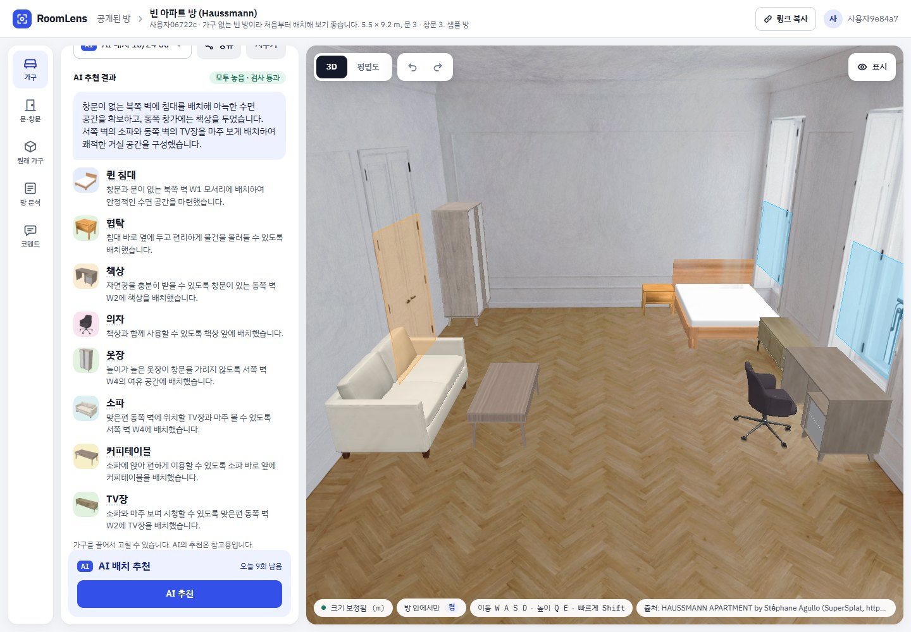 | 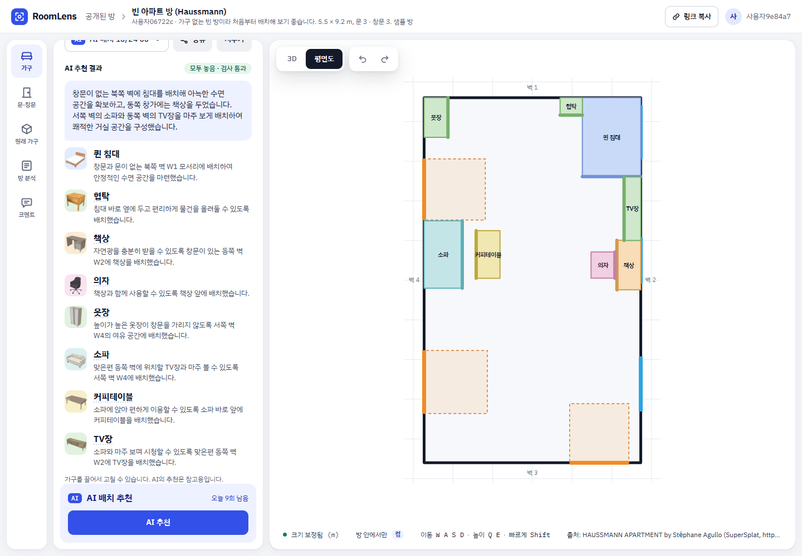 |
| **원래 가구 (AI로 찾고 확인한 결과)** | **AI 방 분석 리포트** |
| 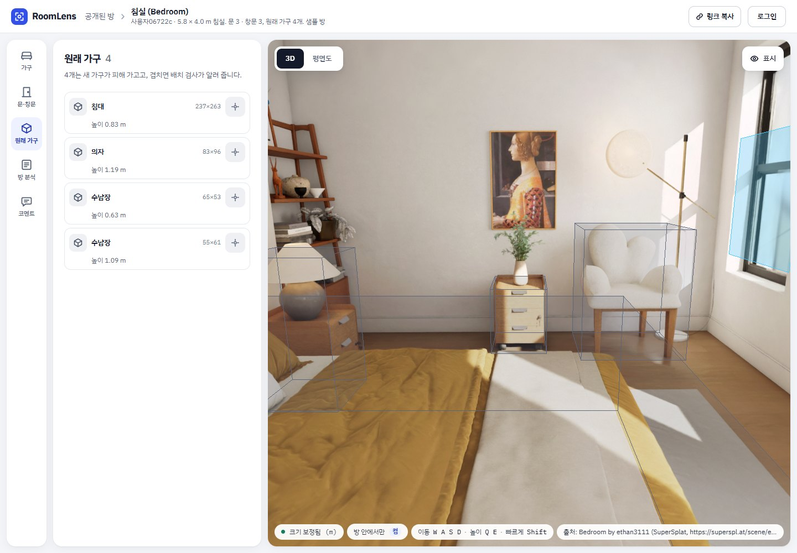 | 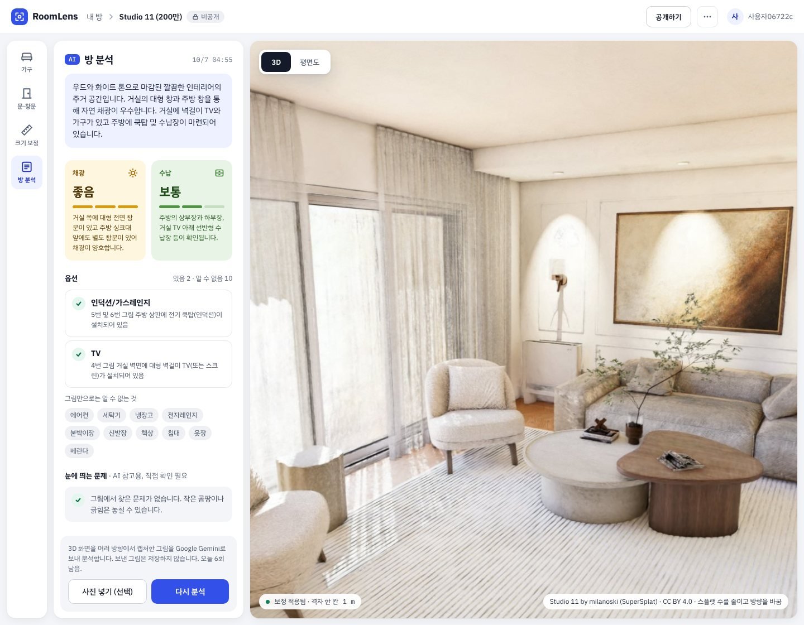 |
| **3D 스캔 가구 올리기** | **방 만들기 (업로드·동의)** |
| 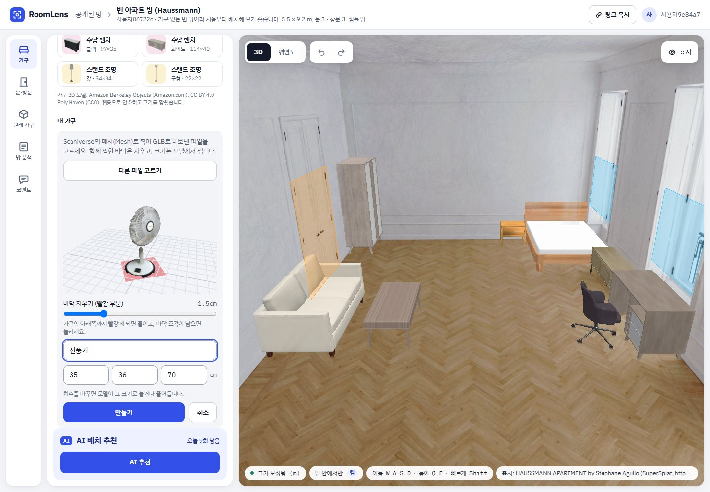 | 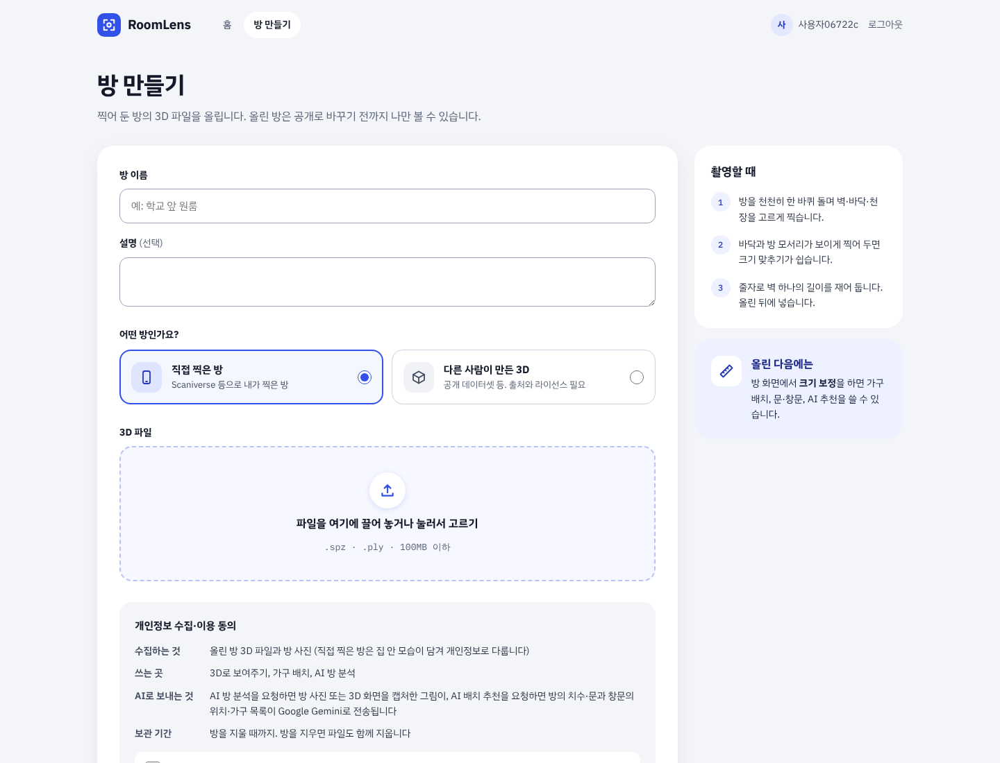 |

| 공개된 샘플 방 | 폰 화면 |
| --- | --- |
| 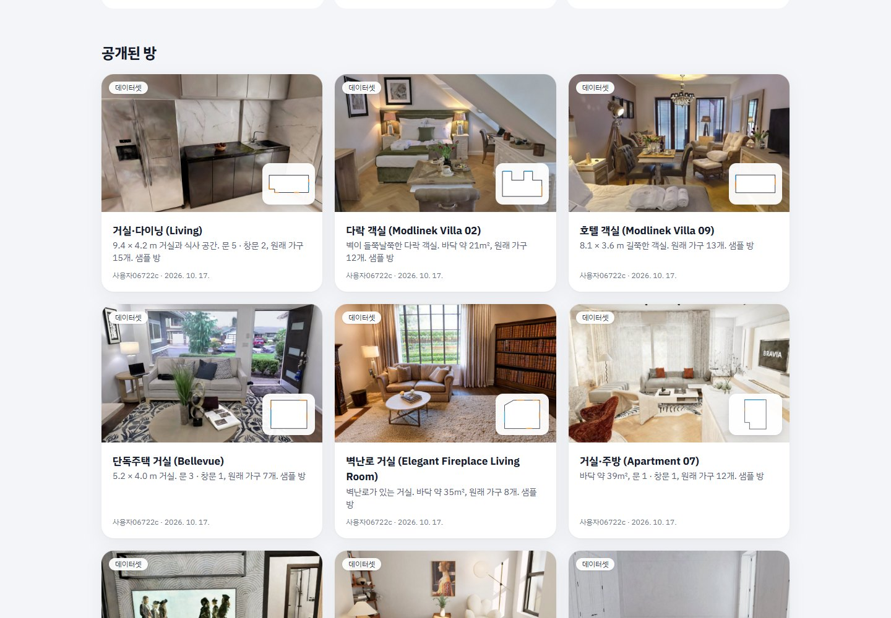 | 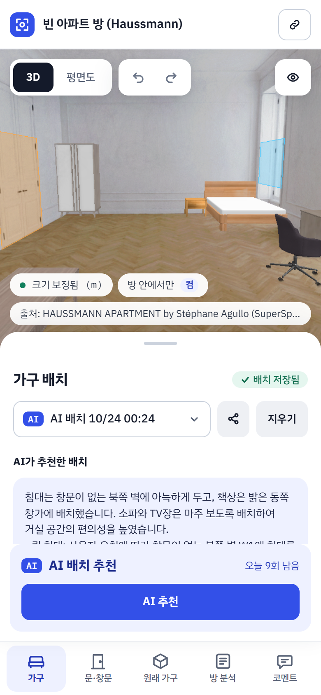 |

- 방 화면은 왼쪽 도구 줄(가구 / 문·창문 / 원래 가구 / 크기 보정 / 방 분석 / 코멘트) + 패널 하나 + 3D 화면 구조입니다. 폰에서는 도구 줄이 아래 탭, 패널이 아래에서 올라오는 판이 됩니다.
- 그림은 운영 사이트에서 공개 샘플 방으로 찍었습니다.

## 사용 흐름

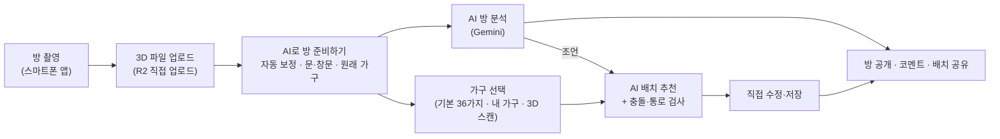

## 생성형 AI 활용

LLM은 "무엇을 어디에 둘지", "그림 속 어디에 문이 있는지" 같은 판단만 맡고, 좌표·치수·충돌처럼 정확해야 하는 계산은 코드가 맡습니다. LLM은 위치·크기 정확도가 낮기 때문입니다.

| 기능 | AI | 입력 | AI가 하는 일 | 코드가 하는 일 |
| --- | --- | --- | --- | --- |
| 3D 방 복원 | 3D 가우시안 스플래팅 (Scaniverse), World Labs Marble(예정) | 방 촬영 / 짧은 영상 | 여러 장의 이미지에서 3D 공간 재구성 | 웹 렌더링(LOD), 자동 보정 |
| 문·창문 찾기 | Gemini 3.8 Flash (비전) | 벽마다 정면 그림 (최대 16장) | 그림 속 문·창문 상자(`box_2d`) | 그림 위치 → 벽 위 구간(m), 겹친 결과 합치기 |
| 원래 가구 찾기 | Gemini 3.8 Flash (비전) | 위에서 본 그림 (1~4장) | 가구 상자와 이름 | 방 좌표 사각형, 높이 재기, 이웃 그림 결과 합치기 |
| 가구 배치 추천 | Gemini 3.8 Flash | 방 요약(벽 길이·문·창문·원래 가구), 가구 목록, 요청 문장 | 가구별 구역·벽·방향·우선순위와 이유를 JSON으로 | 좌표 계산, 6가지 검사, 실패 이유를 붙여 재요청(최대 3회) |
| 빈자리 채우기 | Gemini 그림 모델 (Nano Banana 2.1) | 바닥(위에서)·벽(정면) 그림 + 칠한 빈자리 | 칠한 부분만 주변에 맞춰 이어 그리기 | 평면 찍기, 그림 색으로 납작한 스플랫 깔기, 원래 자국 숨기기 |
| 방 분석 리포트 | Gemini 3.8 Flash (비전) | 위에서 본 그림 + 3D 화면 캡처 + 사진(선택) + 평면도 정보 | 옵션·수납·채광·문제·제안을 JSON으로 | 형식 검증·정리, 저장, 화면 표시 |
| 가구 사진 → 3D | Tripo (예정) | 가구 사진 1장 + 치수 | 형태·질감을 갖춘 GLB 생성 | 작업 상태 확인, R2 저장, 치수 맞춤 |

**AI 출력을 믿을 수 있게 만드는 장치**

- 모든 Gemini 응답은 JSON 스키마(`zod` → `z.toJSONSchema`)로 형식을 지정하고, 받은 뒤 다시 검증합니다.
- 프롬프트에는 좌표·치수를 지어내지 말고 주어진 벽 id(`W1..Wn`)와 가구 id만 쓰라고 지시합니다. 방 요약에는 좌표를 보내지 않습니다.
- 사용자 요청 문장은 줄바꿈을 없애고 200자로 잘라, 방 요약의 구조를 바꾸지 못하게 합니다.
- AI가 찾은 문·창문·원래 가구는 후보로만 넣고, 사용자가 확인한 뒤 저장합니다.
- AI 호출은 로그인한 사람만, 한 사람당 하루 10회까지 (모든 AI 기능이 함께 씀, 방 준비의 문·창문 + 원래 가구 찾기는 1회로 셈).
- 데이터를 학습에 쓰지 않는 Gemini 유료 티어를 씁니다.

## AI 성능 측정

정답이 있는 19개 장면(InteriorGS 11개 + 샘플 방 8개)과 샘플 방 10개로 직접 만든 평가 스크립트(`scripts/dev-data/eval-*.mjs`, `eval-layout-suggest.mts`)로 쟀습니다. 화살표는 10/21 개선 전 → 후입니다.

| 기능 | 지표 | 결과 |
| --- | --- | --- |
| 자동 보정 | 위아래 방향 | 19/19 |
| 자동 보정 | 평면도 겹침(IoU) 평균 / 모서리 오차 | 0.77 → **0.82** / 0.79 → **0.70 m** |
| 문·창문 찾기 | 재현율 / 정밀도 | **0.96 / 0.79** |
| 원래 가구 찾기 | 재현율 / 정밀도 | **0.89 / 0.92** |
| 배치 추천 (10개 방 × 4가지 요청 = 40회) | 문제 없이 끝남 / 요청 지킴 / 평균 시간 | 0.83 → **0.93** / 0.77 → **0.88** / 7.8초 |
| 방 분석 | 장면당 "알 수 없음" / 벽을 짚은 조언 | 8.0 → **6.4** / 32/60 |

- 문·창문 정밀도를 깎는 것은 대부분 집 전체 장면에서 옆방으로 이어지는 통로를 문으로 넣은 것입니다 (정해 둔 동작).
- 칸막이·사선 벽·여러 방이 한 장면에 있는 경우는 자동 보정이 어긋날 수 있어, 평면도에서 벽을 끌어 고치게 했습니다.

## 시스템 구조

무거운 3D 복원은 휴대폰에서, AI는 외부 API에서 처리하고, 큰 파일은 브라우저가 R2에 직접 올립니다. 자동 보정·3D 스캔 다듬기처럼 3D 데이터를 다루는 계산은 브라우저가 맡습니다. 서버는 업로드 주소 발급, AI 호출, 배치 검증만 맡아 Vercel 무료 플랜의 제한(함수 300초, 요청 4.5MB) 안에서 동작합니다.

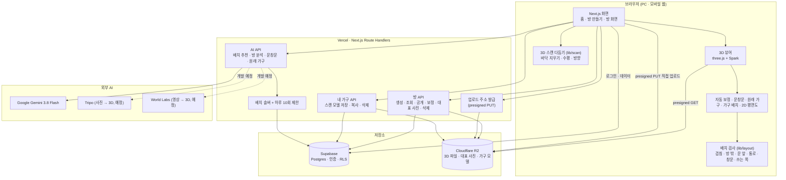

## 기술 스택

| 영역 | 사용 기술 |
| --- | --- |
| 프레임워크 | Next.js 16 (App Router, TypeScript), React 19 |
| 3D | three.js r186, [Spark](https://sparkjs.dev) 2 (3D 가우시안 스플래팅 렌더러, LOD), GLTFLoader + meshopt |
| 스타일 | Tailwind CSS 4, IBM Plex Sans KR / IBM Plex Mono |
| DB·인증 | Supabase (Postgres, 이메일 로그인, Row Level Security) |
| 파일 저장 | Cloudflare R2 (S3 호환, presigned URL) |
| 생성형 AI | Google Gemini 3.8 Flash, Gemini 그림 모델 Nano Banana 2.1 (`@google/genai`), Tripo·World Labs(예정) |
| 스키마 검증 | zod 4 |
| 가구 모델 준비 | glTF Transform (텍스처 WebP·meshopt 압축) |
| 테스트 | vitest (단위 테스트), Playwright 기반 실측·평가 스크립트 |
| 배포 | Vercel |

## 데이터 모델

DB에는 메타데이터와 JSON(보정 값, 배치, 리포트)만 두고, 파일은 모두 R2에 둡니다. 모든 테이블에 RLS를 걸어 본인 데이터와 공개된 방·배치만 읽을 수 있습니다.

| 테이블 | 내용 |
| --- | --- |
| `profiles` | 닉네임, 만 18세 확인 |
| `rooms` | 방 정보, 공개 여부, 3D 파일 키, 보정 값(`transform`), 바닥 평면도(`floor_polygon`), 문·창문(`openings`), 원래 가구(`fixtures`, 떼어 낸 조각·채운 빈자리의 버전 포함), 대표 사진(`thumbnail_key`), 출처(데이터셋 방) |
| `room_reports` | AI 방 분석 리포트 (방마다 최신 하나) |
| `furniture_catalog` | 기본 가구 36가지의 종류·모양·치수, 3D 모델 키, 라이선스 |
| `user_furniture` | 내 가구 (치수로 만듦 / 3D 스캔, 스캔 모델 키) |
| `layouts` | 가구 배치 (`created_by`: `user` / `ai`, AI 요약·이유, 링크 공개 여부). 옮긴 원래 가구는 `kind: 'fixture'` 항목 |
| `comments` | 방 코멘트 |
| `ai_calls` | AI 호출 기록 (하루 10회 제한 계산, 방 준비의 두 호출을 하나로 묶는 `bundle_of`) |
| `jobs` | 오래 걸리는 외부 작업(Tripo·World Labs) 상태 (예정) |

마이그레이션 SQL은 [`supabase/migrations/`](supabase/migrations)에 있습니다.

## 서버 API

| 메서드 | 경로 | 설명 |
| --- | --- | --- |
| `POST` | `/api/rooms` | 방 만들기 (업로드 동의 시각 저장, 한 사람당 10개) |
| `POST` | `/api/upload-url` | 3D 파일을 R2에 올릴 presigned PUT 주소 발급 |
| `GET` · `PATCH` · `DELETE` | `/api/rooms/[id]` | 방 조회, 업로드 확인·공개 전환, 삭제(R2 파일 포함) |
| `PUT` | `/api/rooms/[id]/calibration` | 다시 보정 (배치·문창문·원래 가구를 새 좌표로 옮김) |
| `PUT` | `/api/rooms/[id]/thumbnail` | 대표 사진 저장 (`GET /rooms/[id]/thumbnail`로 보기) |
| `POST` | `/api/rooms/[id]/layout-suggest` | AI 가구 배치 추천 |
| `POST` | `/api/rooms/[id]/analyze` | AI 방 분석 |
| `POST` | `/api/rooms/[id]/openings-suggest` | 문·창문 AI로 찾기 (후보만 돌려줌) |
| `POST` | `/api/rooms/[id]/fixtures-suggest` | 원래 가구 AI로 찾기 (후보만 돌려줌) |
| `POST` · `PATCH` | `/api/rooms/[id]/fixture-pieces` | 떼어 낸 원래 가구 조각·채운 빈자리 조각을 올릴 주소 발급, 올리기 확인 |
| `POST` | `/api/rooms/[id]/fixture-fill` | 빈자리 AI로 채우기 (칠한 그림 → 채운 그림) |
| `POST` | `/api/furniture/scan` | 3D 스캔 가구 만들기 (다듬은 GLB를 R2에 저장) |
| `DELETE` | `/api/furniture/[id]` | 내 가구 지우기 (모델 파일 포함) |
| `POST` | `/api/furniture/[id]/copy` | 공유받은 배치의 스캔 가구를 내 가구로 복사 |
| `DELETE` | `/api/account` | 계정 삭제 (내 방·가구 파일과 DB 데이터 모두) |

## 폴더 구조

```
roomlens/
├─ app/                    # 화면(App Router)과 서버 API(Route Handlers)
│  ├─ page.tsx             # 홈: 공개 방 · 내 방 목록
│  ├─ rooms/new/           # 방 만들기 (업로드 · 동의)
│  ├─ rooms/[id]/          # 방 화면 (3D · 보정 · 문창문 · 원래 가구 · 가구 · 분석 · 코멘트)
│  ├─ account/ · login/    # 내 정보 · 로그인
│  └─ api/                 # rooms, upload-url, furniture, account, AI API
├─ components/
│  ├─ viewer/              # 3D 뷰어, 보정·방 준비, 문·창문, 원래 가구, 분석, 코멘트 패널
│  ├─ layout/              # 가구 배치 레이어, 2D 평면도, 3D 스캔 가구, 배치 공유
│  └─ rooms/ · home/ · ui/ · auth/
├─ lib/
│  ├─ three/               # 보정 변환, 자동 보정, 직각 맞추기, 캡처, 카메라, 가구·스캔 모델
│  ├─ rooms/               # 평면도 윤곽 찾기, 보정 저장·다시 보정, 문창문, 원래 가구, 대표 사진
│  ├─ layout/              # 기하(SAT), 배치 검사, 통로 BFS, 배치 솔버, 되돌리기, 공유
│  ├─ ai/                  # Gemini 호출, 프롬프트, 스키마, 방 요약, 벽 정면 그림, 호출 제한
│  ├─ scan/                # 3D 스캔 바닥 찾기·지우기, GLB 확인
│  ├─ eval/                # 방 준비 평가 채점
│  └─ upload/ · supabase/ · auth/ · viewer/ · r2.ts
├─ supabase/migrations/    # DB 스키마 · RLS
├─ scripts/                # 개발용 데이터 · 가구 모델 · 실측·평가 스크립트
└─ tests/                  # vitest 단위 테스트
```

## 개발 현황과 일정

| 단계 | 기간 (계획) | 내용 | 상태 |
| --- | --- | --- | --- |
| M0 기술 검증 | 9/29 ~ 10/5 | 3D 뷰어, 크기 보정 프로토타입, 가구 드래그, Gemini 구조화 출력 | 완료 (10/4) |
| M1 업로드·저장 | 10/6 ~ 10/12 | 로그인, R2 업로드, 방 만들기·방 화면, 공개/비공개·삭제 | 완료 (10/5) |
| M2 보정·가구 배치 | 10/13 ~ 10/19 | 다각형 보정, 문·창문, 기본 가구·내 가구, 6가지 검사, 2D 평면도, 배치 저장 | 완료 (10/5) |
| M3 AI | 10/20 ~ 10/26 | AI 배치 추천, AI 방 분석, 문·창문 AI로 찾기, 화면 디자인 적용 | 완료 (10/7) |
| M4 기능 완성·공개 | 10/27 ~ 11/2 (앞당겨 진행 중) | 실사 가구 36가지, 원래 가구, AI로 방 준비하기, 되돌리기·자유 회전, 공유(코멘트·배치 링크), 샘플 방 10개 공개·대표 사진, AI 성능 개선, 3D 스캔 가구, 원래 가구 옮기기·빈자리 AI로 채우기 (여기까지 완료) / 가구 사진 → 3D, 영상 → 3D | 진행 중 |
| M5 사용자 테스트 | 11/3 ~ 11/16 | 사용자 10명 이상, 만족도 설문(10문항 이상), 개선, 11/16 최종 완성 | 예정 |
| 발표 | 11/17 ~ 발표일 | 발표 자료, 시연 영상, 리허설 | 예정 |

작업은 이슈 → 브랜치 → PR → merge commit 순서로 진행합니다 (squash 하지 않음).

## 로컬 실행

Node.js 22 이상이 필요합니다.

```bash
npm install
cp .env.example .env.local   # 값 채우기
npm run dev
```

http://localhost:3000 에서 확인합니다.

| 환경변수 | 용도 |
| --- | --- |
| `NEXT_PUBLIC_SUPABASE_URL`, `NEXT_PUBLIC_SUPABASE_PUBLISHABLE_KEY` | Supabase 프로젝트 주소·공개 키 |
| `SUPABASE_SECRET_KEY` | 서버 전용 작업 |
| `R2_ACCOUNT_ID`, `R2_ACCESS_KEY_ID`, `R2_SECRET_ACCESS_KEY`, `R2_BUCKET` | Cloudflare R2 |
| `GEMINI_API_KEY`, `GEMINI_MODEL`, `GEMINI_IMAGE_MODEL` | Gemini (기본 `gemini-3.8-flash`, 그림 모델 `gemini-nano-banana-2.1`) |
| `UNLIMITED_ROOM_USER_IDS` | 방 개수 제한(10개)을 받지 않는 계정 id, 쉼표로 구분 (선택) |
| `TRIPO_API_KEY`, `WORLDLABS_API_KEY` | 가구 사진 → 3D, 영상 → 3D (예정) |

키는 `.env.local`과 Vercel 환경변수에만 두고 저장소에 올리지 않습니다.

## 테스트

```bash
npm test        # vitest 단위 테스트 (635개)
npm run lint
npm run build
```

- 단위 테스트는 브라우저 없이 도는 순수 계산(보정 변환, 평면도 윤곽 찾기, 직각 맞추기, 겹침·통로 검사, 배치 솔버, 방 요약, 문·창문·원래 가구 위치 계산, 스캔 바닥 찾기 등)을 다룹니다.
- `scripts/dev-data/e2e-*.mjs`는 실제 브라우저로 화면을 조작해 업로드·보정·가구 배치·AI 기능·공유를 확인하는 실측 스크립트이고, `eval-*`는 정답 장면으로 AI 성능을 재는 평가 스크립트입니다.

## 개인정보와 안전장치

- 방 3D 파일과 사진은 집 안 모습이 담긴 개인정보로 다룹니다. 업로드 전에 수집 항목·용도·AI 전송·보관 기간을 보여 주고 동의를 받습니다.
- 올린 방은 기본 비공개이고, 방을 지우면 R2의 파일도 함께 지웁니다. 계정을 지우면 내 방·내 가구의 파일과 배치·코멘트·AI 기록까지 모두 지웁니다.
- AI 방 분석에 보낸 그림은 저장하지 않습니다.
- Gemini 약관에 따라 만 18세 이상만 가입할 수 있습니다.
- 가격·계약 조건·연락처는 받지 않습니다 (매물 광고로 쓰이지 않도록).

## 데이터·모델 출처와 라이선스

| 자료 | 출처 | 라이선스 | 쓰는 곳 |
| --- | --- | --- | --- |
| 가구 3D 모델 | [Amazon Berkeley Objects](https://amazon-berkeley-objects.s3.amazonaws.com/index.html) (Amazon.com) | [CC BY 4.0](https://creativecommons.org/licenses/by/4.0/) | 기본 가구 35가지 |
| 책장 (Shelf_01) | [Poly Haven](https://polyhaven.com/a/Shelf_01) | CC0 | 기본 가구 1가지 |
| Studio 11 | milanoski, [SuperSplat](https://superspl.at/scene/c37cb759) | CC BY 4.0 | 샘플 방, 홈·화면 예시 그림 |
| HAUSSMANN APARTMENT | Stéphane Agullo (sa3d), [SuperSplat](https://superspl.at/scene/4de797f4) | CC BY 4.0 | 가구 없는 샘플 방, 화면 예시 그림 |
| 그 밖의 샘플 방 8개 | milanoski, ethan3111, tosolini, adamassets, leninlpg777, andriishramko, [SuperSplat](https://superspl.at) | CC BY 4.0 | 샘플 방 (방 화면에 장면마다 출처 표시) |
| InteriorGS | Hugging Face 데이터셋 | 비상업 연구·교육 전용 | 개발 중 검증·평가용 (저장소·공개 방에 올리지 않음) |

- 가구 모델은 웹용으로 메시·텍스처를 압축하고 크기를 맞췄습니다 (`scripts/dev-data/build-furniture-models.mjs`). 목록의 작은 사진(`public/furniture/`)은 이 모델을 그린 것입니다 (`scripts/dev-data/render-furniture-thumbs.mjs`).
- 샘플 방은 방향을 바꾸고 스플랫 수를 줄여 쓰며, 보정·문창문·원래 가구는 `scripts/dev-data/setup-sample-room.mjs`로 준비합니다.
- 데이터셋 원본·변환 파일은 저장소에 포함하지 않습니다.
